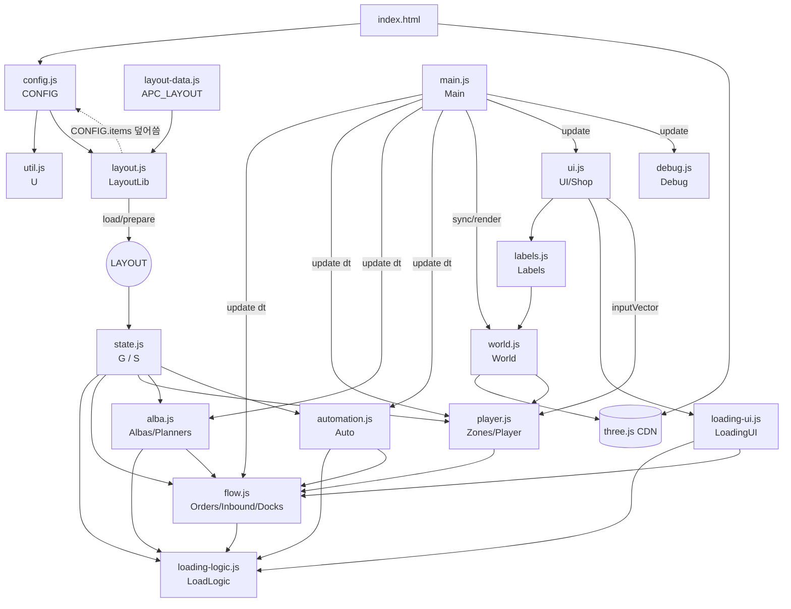

# APCenter 목업 — Unity 포팅 사전 분석

- 분석 기준: 작업 트리 현재 상태 (커밋 `753dfa4` + 미커밋 수정분 `css/style.css`, `js/debug.js`, `js/main.js` 포함)
- 범위: `index.html`에서 실제로 로드·실행되는 코드만
- 제외: **에디터 영역** (`editor.html`, `js/editor/*`, `css/editor.css`). `js/layout.js` 중 에디터 전용 함수도 "에디터 영역"으로만 표기
- 코드에서 확인되지 않는 내용은 "확인 불가"로 표기

---

## 1. 진입점과 로딩 순서

`index.html`은 모듈 시스템(import/export, 번들러) 없이 일반 `<script>` 태그로 순서대로 로드한다. 모든 모듈은 **전역 상수 객체**(`const CONFIG`, `const S`, `const World` …)로 선언되어 서로를 전역 이름으로 참조한다.

| 순서 | 파일 | 종류 | 로드 시 즉시 실행되는 것 |
|---|---|---|---|
| 1 | `css/style.css` | CSS (`<head>`) | – |
| 2 | (DOM 골격) | HTML `<body>` | `#view`(canvas), `#labels`, `#hud`(7개 하위 div), `#panel`, `#debug`, `#loading-overlay`, `#drag-ghost` 생성 |
| 3 | `three@0.149.0/build/three.min.js` | 외부 CDN (jsdelivr) | 전역 `THREE` |
| 4 | `js/config.js` | JS | `CONFIG` 정의 |
| 5 | `js/util.js` | JS | `U` 정의 |
| 6 | `js/layout.js` | JS | `LayoutLib` 정의 + 파일 끝에서 `LayoutLib.BASE_ITEMS`, `BASE_COST`를 `CONFIG.items`로부터 계산 |
| 7 | `layout-data.js` | JS(데이터) | `window.APC_LAYOUT = null` |
| 8 | 인라인 스크립트 | JS | `const LAYOUT = LayoutLib.load();` → 배치 확정 + `CONFIG.items` 덮어쓰기 + 벨트 그래프 계산 |
| 9 | `js/state.js` | JS | `let G = null`, `createState()`, `S` 정의 |
| 10 | `js/minigame/loading-logic.js` | JS | `LoadLogic` 정의 |
| 11 | `js/flow.js` | JS | `Orders`, `Inbound`, `Docks` 정의 |
| 12 | `js/player.js` | JS | `ROLE_NAMES`, `FACILITY_ROLES`, `Zones`, `Player` 정의 |
| 13 | `js/alba.js` | JS | `NAME_*`, `Step`, `Albas`, `nearestOf`, `Planners` 정의 |
| 14 | `js/automation.js` | JS | `Auto` 정의 |
| 15 | `js/world.js` | JS | `COLORS`, `World` 정의 |
| 16 | `js/labels.js` | JS | `Labels` 정의 |
| 17 | `js/ui.js` | JS | `$`, `Shop`, `UI` 정의 |
| 18 | `js/minigame/loading-ui.js` | JS | `LoadingUI` 정의 |
| 19 | `js/debug.js` | JS | `SKILL_NAMES`, `Debug` 정의 |
| 20 | `js/main.js` | JS | `Main` 정의 + **파일 마지막 줄 `Main.init()` 호출 → 게임 시작** |

### 1-1. `LayoutLib.load()` 배치 결정 순서 (`js/layout.js`)
1. URL 해시 `#layout=...` (에디터 영역의 테스트 플레이 기능) → JSON 파싱
2. 없으면 `window.APC_LAYOUT` (`layout-data.js`) — 현재 값 `null`
3. 없으면 `LayoutLib.makeDefault()` (하드코딩 기본 배치)
4. `LayoutLib.upgrade()`(v1→v2 변환) → `LayoutLib.validate()` 에러 있으면 기본 배치로 대체
5. `LayoutLib.prepare(l)`:
   - `CONFIG.items = LayoutLib.items(l)` (배치의 품목 목록으로 **CONFIG를 런타임에 덮어씀**)
   - `l.bounds` (플레이어 이동 한계), `l._graphs` (벨트 경로 그래프), `l._routes` (경로 캐시 Map)
   - `CONFIG.facility.parking.values/costs`를 주차 슬롯 수에 맞게 재계산

→ 현재 상태에서는 **기본 배치(`makeDefault`)가 사용됨**.

### 1-2. `Main.init()` 초기화 순서 (`js/main.js`)
```
G = createState()                       state.js
Player.init()                           player.js   → G.player 생성
G.inTrucks[0] 즉시 도착 + 물품 롤          S.rollInboundItems()
Albas.rerollCandidates()                alba.js     → G.candidates
World.init(canvas)                      world.js    → Three.js 씬/카메라/조명/정적 메시
UI.init()                               ui.js       → Labels.init, buildHud, buildLabels, bindInput
LoadingUI.init()                        loading-ui.js
Debug.init()                            debug.js
UI.toast(환영/배치 정보)
window.APC = {...}                      콘솔 디버그용 노출
?test 쿼리면 Main.selfTest()             (자체 점검, 개발용)
requestAnimationFrame(Main.frame)       메인 루프 시작
```

---

## 2. 파일별 역할 요약

| 파일 | 주요 전역 | 역할 | 의존(참조) 대상 |
|---|---|---|---|
| `index.html` | – | DOM 골격, 스크립트 로드 순서 정의 | – |
| `css/style.css` | – | 전체 HUD/패널/라벨/미니게임 스타일 | – |
| `js/config.js` | `CONFIG` | 모든 밸런스 수치·정적 데이터 (품목, 목적지, 공정, 트럭 종류, 블록 모양 등) | 없음 |
| `js/util.js` | `U` | 랜덤, 가중치 추첨, 셔플, 거리, DOM 생성(`U.el`), 진행바 HTML(`U.bar`), 금액 포맷 | 없음 |
| `js/layout.js` | `LayoutLib` | 맵 배치 데이터 생성/검증/로드, 벨트 라인 → 방향 그래프 → 최단 경로(다익스트라) | `CONFIG` |
| `layout-data.js` | `window.APC_LAYOUT` | 외부 배치 데이터 주입점 (현재 `null`) | – |
| `js/state.js` | `G`, `createState`, `S` | 게임 상태 객체 생성, 상태 조회/판정 헬퍼(용량, 재고, 위치 좌표, 돈 지출) | `CONFIG`, `LAYOUT`, `LayoutLib`, `U`, `UI.toast` |
| `js/minigame/loading-logic.js` | `LoadLogic` | 상차 미니게임 순수 로직: 트럭 생성, 배치 가능 판정, 적재율, 랭크, 특수 목표, 정산 | `CONFIG`, `G`, `U`, `S.TRUCK_AWAY` |
| `js/flow.js` | `Orders`, `Inbound`, `Docks` | 주문 생성/포장대 배정/포장(박스화), 입고 트럭 순환, 출고 트럭 순환/출발 정산 | `G`, `S`, `CONFIG`, `U`, `LoadLogic`, `UI`, `LoadingUI` |
| `js/player.js` | `Zones`, `Player` | 상호작용 범위 계산, 플레이어 이동 + 범위 내 자동 작업 | `G`, `S`, `CONFIG`, `U`, `LAYOUT`, `Orders`, `UI`, `LoadingUI` |
| `js/alba.js` | `Step`, `Albas`, `Planners` | 알바 고용/해고/배치, 계획(plan) 기반 AI, MT/휴식/시급/파손 | `G`, `S`, `CONFIG`, `U`, `LAYOUT`, `World`, `UI`, `Docks`, `Orders`, `LoadLogic` |
| `js/automation.js` | `Auto` | Lv4 자동화: 컨베이어 물품 이동(flyer), 검수 기계손, 포장 기계, 상차 기계 | `G`, `S`, `CONFIG`, `LayoutLib`, `LAYOUT`, `Orders`, `Docks`, `LoadLogic` |
| `js/world.js` | `COLORS`, `World` | Three.js 렌더링: 씬 구성, 상태 → 메시 동기화, 카메라/줌, 좌표 변환 | `THREE`, `G`, `S`, `CONFIG`, `LAYOUT`, `LayoutLib`, `Zones`, `U` |
| `js/labels.js` | `Labels` | 3D 좌표에 붙는 DOM 라벨 (매 프레임 화면 좌표로 투영) | `U`, `World.project` |
| `js/ui.js` | `$`, `Shop`, `UI` | 구매/업그레이드(`Shop`), 입력 바인딩, HUD, 주문서 스트립, 월드 라벨 내용, 사이드 패널 3종, 간식 드래그, 토스트 | 거의 전체 |
| `js/minigame/loading-ui.js` | `LoadingUI` | 상차 미니게임 오버레이 화면, 드래그/회전/배치/회수 입력 | `LoadLogic`, `G`, `S`, `CONFIG`, `U`, `UI`, `Docks` |
| `js/debug.js` | `Debug` | 디버그 패널(돈/낮밤/이벤트/주문/트럭/알바 스탯 치트). 목업 테스트용 | `G`, `S`, `CONFIG`, `U`, `UI`, `Main`, `Orders`, `Albas`, `LoadingUI` |
| `js/main.js` | `Main` | 초기화, 메인 루프(고정 스텝 업데이트), 낮/밤 전환, 이벤트, 자체 점검(`?test`) | 전체 |

### 2-1. 에디터 영역 (분석 제외)
- `editor.html`, `js/editor/editor.js`, `js/editor/panels.js`, `js/editor/view.js`, `js/editor/selftest.js`, `css/editor.css` — `index.html`에서 로드하지 않음
- `js/layout.js` 중 게임 런타임에서 호출되지 않는 함수 (`facilities`, `points`, `footprint`, `measure`, `autoLines`, `beltPairs`, `attachName` 등)는 `validate()`/`upgrade()`/`selfTest()` 내부 사용 외에는 에디터 영역. 단 `validate()`는 `load()`에서 호출되므로 런타임에 실행됨.

---

## 3. 의존/호출 관계도



### 3-1. 역방향(하위 → 상위) 호출 — 포팅 시 결합도 주의
| 호출자 | 피호출 | 근거 |
|---|---|---|
| `S.spend` (state.js) | `UI.toast` | 돈 부족 토스트 |
| `Albas.hire/fire` (alba.js) | `World.addAlba/removeAlba` | 로직에서 렌더 메시 직접 생성/삭제 |
| `Docks.depart` (flow.js) | `LoadingUI.close`, `UI.toast` | 출발 시 미니게임 창 닫기 |
| `Player.loadableDock` (player.js) | `LoadingUI.canOpen` | 미니게임 열기 가능 판정이 UI 객체에 있음 |
| `UI.inputVector` (ui.js) | `World.camera`, `World.center` | 카메라 방향 기준 WASD 보정 |
| 다수 로직 | `UI.toast` | 피드백 메시지 |

---

## 4. 화면(Screen/View) 구성

화면 전환 라우터/씬 개념은 **없음**. 단일 페이지에서 레이어(DOM 요소)를 `.hidden` 클래스(`display:none !important`) 토글로 보이고 숨긴다.

### 4-1. 화면(레이어) 목록

| 레이어 | DOM | z-index (style.css) | 열기/닫기 | 게임 정지 여부 |
|---|---|---|---|---|
| 3D 월드 | `#view` (canvas) | 기본 | 항상 표시 | – |
| 월드 라벨 | `#labels` | 기본 (`pointer-events:none`, 잠금 라벨·상차 버튼만 클릭 가능) | 항상 표시 | – |
| HUD | `#hud > *` | 5 | 항상 표시 | – |
| 사이드 패널 (시설/업그레이드/알바) | `#panel` | 10 | `UI.openPanel(name)` / `UI.closePanel()` (메뉴 버튼, 같은 버튼 재클릭 토글, ESC, ✕) | 정지 안 함 |
| 디버그 패널 | `#debug` | 12 | `Debug.toggle()` (메뉴 🛠️ 버튼, `` ` `` 키) | 정지 안 함 |
| 상차 미니게임 | `#loading-overlay` | 20 (반투명 전체 덮개) | `LoadingUI.open(d)` / `LoadingUI.close()` | **`G.paused = true`** |
| 간식 드래그 고스트 | `#drag-ghost` | 50 | `UI.startSnackDrag` 중 표시 | – |
| 미니게임 블록 고스트 | `.ld-ghost` (동적 생성, body에 append) | 60 | `LoadingUI.startDrag` / `cancelDrag` | – |
| 자체 점검 출력 | `#test-out` | 99 | `?test` 쿼리일 때만 (개발용) | – |

### 4-2. UI 요소 계층

```
body (night 클래스 토글)
├─ canvas#view                         ← World (Three.js)
├─ div#labels                          ← Labels (absolute div.lbl 다수)
│   ├─ 입고 트럭 라벨 ×N               UI.buildLabels: L.inTrucks
│   ├─ 하차장 라벨                     L.staging
│   ├─ 보관함 라벨 ×N (잠금 시 해금 버튼) L.bins  (data-act="buy-bin")
│   ├─ 포장대 라벨 ×N (잠금 시 해금 버튼) L.tables (data-act="buy-table")
│   ├─ 도크 라벨 ×N (잠금 해금 / [E] 상차하기 버튼) L.docks (buy-dock / open-load)
│   ├─ 쓰레기통 / 휴게실 / 대기구역 / 공기청정기(잠금 시 설치 버튼)
│   ├─ 플레이어 라벨 (손 아이콘, 현재 구역명, 행동, 진행바)
│   └─ 알바 라벨 ×N (표정, 이름, 손 아이콘, MT 바, 진행바)   UI.albaLabels (동적 추가/삭제)
├─ div#hud
│   ├─ #clock-box   (UI.buildHud)
│   │   ├─ .clock: #clk-icon ☀️/🌙, #clk-day "N일차 낮", #clk-time "HH:MM"
│   │   ├─ .phase-bar > #clk-bar (낮/밤 진행)
│   │   ├─ #money
│   │   ├─ .speed: [⏸][x1][x2][x4]  (data-speed)
│   │   └─ #stats (출고 트럭/박스/파손 수)
│   ├─ #order-strip  (UI.renderOrders: .order 카드, 넘치면 .order.more)
│   ├─ #event-banner (이벤트 중에만 표시, pulse 애니메이션)
│   ├─ #snack-bar    (간식 3종 .snack, 드래그 시작점)
│   ├─ #menu-bar     ([🏗️ 시설][⬆️ 업그레이드][👷 알바 n/12][🛠️ 디버그])
│   ├─ #toasts       (최대 5개, 3.6초 후 페이드, 4.2초 후 제거)
│   └─ #help         (조작 안내 텍스트)
├─ div#panel  (UI.renderPanel → UI['panel_' + name]())
│   ├─ panel_facility : 보관함(품목) 해금 / 포장대 해금 / 출고 도크 해금 / 케어시설(휴게실·공기청정기)
│   ├─ panel_upgrade  : 공정 Lv(7개) / 물류 시설(주차·하차장·보관함 용량) / 상차 미니게임 업그레이드(압축·우선칸)
│   └─ panel_alba     : 지원자 3명 카드(.cands grid) + 재추첨 / 공정 배치 현황 칩 / 직원 카드(.alba: 스탯, MT바, 숙련도, 공정 select, 상태, 해고)
├─ div#debug  (Debug.render: 디버그 영역 — 목업 테스트용)
├─ div#loading-overlay  (LoadingUI.render)
│   └─ .ld-panel (고정 1180×720, max 96vw×94vh)
│       ├─ .ld-top : 제목(목적지·트럭 종류·크기), 적재율+바, 예상 대금 산식
│       ├─ .ld-body
│       │   ├─ .ld-left  : 특수 목표 체크리스트, 타입 랭크, 적재 배율 설명, 업그레이드 현황
│       │   ├─ .ld-center: 운전석 표시 / .ld-grid (cell, piece, .ld-preview) / 짐칸 문 표시
│       │   └─ .ld-right : 출고 대기 박스 카드 목록 (.box-card, 미니 모양)
│       └─ .ld-bottom: [🚚 출발][↺ 초기화][✕ 닫기] + 조작 안내
└─ div#drag-ghost
```

### 4-3. 3D 월드 오브젝트 계층 (`World.buildStatic`, `World.sync`)
| 오브젝트 | 생성 함수 | 형태 | 동기화(상태 → 표시) |
|---|---|---|---|
| 바깥 땅 / 창고 바닥 / 구역 바닥 / 휴게실·대기구역 바닥 | `buildStatic`, `floor` | Plane | 밤에 바깥 땅·배경만 어두워짐 (`syncLighting`) |
| 벽 | `buildStatic` | Box | 정적 |
| 하차장 팔레트 + 큐브 18칸 | `cubeSlots(3,3,2)` | Box | `G.staging.length`만큼 표시, 품목 타입 색 |
| 입고 트럭 ×주차슬롯 | `makeTruck` | Box+Cylinder 조합 | `S.truckPos(slot, off)`로 위치, `away`면 숨김 |
| 보관함 ×품목 | group(body, sign, cube×10, 파손큐브, 기계손) | Box | 재고량/2 개 큐브, 검수완료는 타입 색, 미검수는 골판지 색; 잠금 시 반투명 |
| 포장대 ×N | group(top, item×6, box×4, machine) | Box | 전달 물품·완성 박스 수, Lv4 포장 기계 표시·흔들림 |
| 출고 도크 ×목적지 | group(pad, 팔레트, cube 18, 기계손) | Plane+Box | 대기 박스 수, 패드 목적지 색 |
| 출고 트럭 | `makeTruck(목적지색)` | – | `d.truck` 생기면 생성, 없어지면 씬에서 제거 |
| 쓰레기통 / 벤치 | `cyl`, `box` | – | 정적 |
| 휴게실 가구 | `syncCare` | 티어별 재생성 | `G.care.rest` 바뀔 때 `restGroup.clear()` 후 재구성 |
| 공기청정기 | `syncCare` | 티어별 재생성 | `G.care.purifier`, 팬 회전 |
| 플레이어 / 알바 캐릭터 | `makeChar` | Capsule + Sphere + 모자 | 위치·방향, 이동 시 bob, 손 스택(`setStack`), 휴식 시 눕힘/회색 |
| 상호작용 범위 원 | `makeRing` (`syncZones`) | Circle+Ring | `Zones.list()` 기준 생성/숨김, 현재 구역 강조·맥동 |
| 클릭 이동 마커 | `buildStatic` | Ring | `G.player.target` |
| 컨베이어 벨트 | `syncBelts` → `belt()` | Box | 해당 공정 Lv4 최초 도달 시 1회 생성 |
| 이동 물품(flyer) | `syncFlyers` | Box | `G.flyers` 위치 |

카메라: `OrthographicCamera`, 오프셋 `(8, 48, 36)` 고정 각도. 조명: `HemisphereLight` + 그림자 있는 `DirectionalLight`.

---

## 5. 상태 관리

### 5-1. 전역 변수
| 전역 | 선언 위치 | 성격 |
|---|---|---|
| `CONFIG` | `config.js` | 정적 설정. 단 `LayoutLib.prepare`가 `CONFIG.items`, `CONFIG.facility.parking.values/costs`를 런타임 1회 덮어씀 |
| `LAYOUT` | `index.html` 인라인 | 맵 배치 (읽기 전용으로 사용. `_routes` 캐시만 런타임에 채움) |
| `G` | `state.js` (`let G = null`, `Main.init`에서 `createState()`) | **유일한 가변 게임 상태** |
| `S` | `state.js` | 상태 판정 함수 묶음 + 상수 `S.TRUCK_AWAY = 15` |
| 모듈 객체 내부 상태 | `World.*`, `UI.keys/panelName/timers/albaLabels`, `Labels.items`, `LoadingUI.dock/drag`, `Debug.open/albaId`, `Main.last` | 뷰/입력 상태 |
| `window.APC` | `Main.init` | 콘솔 디버깅용 노출 |

저장(세이브/로드): **없음** (`localStorage`/파일 저장 코드 확인되지 않음). 새로고침 시 초기화.

### 5-2. 데이터 모델 (`createState()`, `state.js`)
```
G
├─ time, phase('day'|'night'), phaseTime, day
├─ speed(1|2|4), userPaused, paused(미니게임 열림)
├─ money, stats{earned, shipped, broken, trucks}
├─ bins[]      : idx, item, slot, unlocked, unchecked, checked, broken,
│                incomingRaw, reservedPick, inFlightPick, inspector, armProgress
├─ staging[]   : 품목 idx 배열 (하차장)
├─ inTrucks[]  : idx, slot, state('away'|'arriving'|'present'|'leaving'), items[], timer, off
├─ fac         : { parking, staging, bin } 레벨
├─ tables[]    : idx, slot, unlocked, order, delivered{}, packer, packProgress, machineProgress, boxes[]
├─ docks[]     : idx, slot, unlocked, waiting[](박스), truck, truckTimer, loader, autoTimer, stuckTimer
├─ orders[]    : { id, dest, items{품목idx: 수량}, units, reward, table }
├─ orderTimer, seq{order, box, alba}
├─ albas[]     : (Albas.hire) name, str, agi, int, wage, id, mt, skills{lift,carry,pack,inspect},
│                stage, x, z, facing, moving, hand[], plan[], pickRes{}, wantRest, resting, restT,
│                unpaid, flee, status, progress, fx
├─ candidates[]: { name, str, agi, int, wage }
├─ stages      : { unload..load: 1~4 }  (4 = 자동화)
├─ care        : { rest: 0~3, purifier: -1~3 }
├─ loadUpg     : { compress, bonus }
├─ auto        : { sort, transfer, outbound } 타이머
├─ flyers[]    : { kind, ref, path[], seg, x, z, onArrive }
├─ event       : null | { name }
└─ player      : (Player.init) x, z, facing, moving, hand[], target, timer,
                 zone, zoneKey, zoneMode, progress, busy, action
```

부속 모델:
- **손 아이템(hand entry)** (`player.js`, `alba.js`): `{kind:'raw', item, reserved?}` / `{kind:'pick', item}` / `{kind:'box', box}` / `{kind:'broken', item}`. 한 손에는 같은 kind만 (`S.canTake`).
- **박스** (`Orders.pack`): `{ id, order, dest, reward, units, shape, cells[[x,y]], types[], primary, items{}, claimedBy }`
- **출고 트럭** (`LoadLogic.createTruck`): `{ def, w, h, locked:Set, bonus:Set, objectives[], placements[{box,cells}], mode(null|'manual'|'auto'), autoCells, autoBoxes[], autoTarget, state, off }`
- **알바 계획 단계** (`Step`): `{t:'move', x, z}` / `{t:'act', fn(a, dt) → false|true|'more'|'abort'}` (클로저 기반)

### 5-3. 상태 변경·공유 방식
- 모든 모듈이 전역 `G`를 **직접 읽고 직접 변경**한다. 이벤트 버스/옵저버/스토어 패턴 없음.
- 재고 정합성은 예약 카운터로 유지: `incomingRaw`(분류 이동 중), `reservedPick`(알바가 집으러 가는 중), `inFlightPick`(컨베이어 이동 중), `inspector`/`packer`/`loader`/`claimedBy`(점유권). 정합성 검사는 `Main.checkInvariants`.
- 뷰 갱신은 **폴링**: `World.sync`는 매 프레임, `UI.refreshHud` 0.2초, `UI.refreshLabels` 0.1초, `UI.renderPanel` 0.5초 주기 (`UI.update`의 `timers`). 버튼 클릭 직후에는 `renderPanel(true)`/`refreshHud()` 강제 호출.
- 불필요한 재생성 방지: `World`는 객체별 `sig` 문자열 비교, `Labels.set`은 HTML 동일 시 skip, `UI.renderPanel`은 `panelSignature()` 비교 + select 포커스 중이면 재렌더 생략.

---

## 6. 이벤트/인터랙션 흐름

### 6-1. 메인 루프 (`Main.frame`)
```
requestAnimationFrame
→ dt = min(0.1, 경과초)
→ running = !G.paused && !G.userPaused
→ running이면 dt*G.speed 를 0.05초 단위로 쪼개 Main.update(s) 반복   (고정 스텝)
     Main.update: G.time/phaseTime 증가 → (phaseSeconds 도달 시) Main.switchPhase
                  → Inbound.update → Orders.update → Docks.update
                  → Player.update(dt, UI.inputVector()) → Albas.update → Auto.update
→ World.sync(running ? dt*speed : 0) → World.updateCamera(dt)
→ UI.update(dt) (HUD/라벨/패널 주기 갱신 + Labels.update 투영)
→ Debug.update(dt) → World.render()
```

### 6-2. 사용자 입력 흐름 (트리거 → 함수 → 결과)

| 트리거 | 핸들러 (파일: 함수) | 상태 변경 | 화면 갱신 |
|---|---|---|---|
| WASD/방향키 누름 | `ui.js: bindInput` keydown → `UI.keys.add` | (다음 update에서) `Player.update`가 `UI.inputVector()`로 `G.player.x/z/facing` 변경, `target=null` | `World.syncChar`, 카메라 추종(줌>1일 때) |
| 캔버스 좌클릭 | `ui.js: bindInput` pointerdown → `World.groundPoint` (레이캐스트) | `G.player.target = {x,z}` (bounds로 clamp) | 이동 마커 표시 (`World.sync`) |
| 마우스 휠 | `ui.js` wheel → `World.zoomBy` | `World.zoom` (1~2.6) | `World.updateCamera` 보간 |
| 상호작용 범위 진입 후 대기 | `player.js: Player.update` → `Zones.nearest` → `interactDelay` 경과 → `Player.act` → `actPart`/`actBin`/`actTable` | 손·트럭·하차장·보관함·포장대·도크 상태 변경 (아래 6-3) | 라벨 행동 텍스트/진행바, 3D 큐브 수 |
| `E` 키 | `ui.js` keydown → `Player.loadableDock()` → `LoadingUI.open(d)` | `G.paused = true`, `UI.keys.clear()` | 미니게임 오버레이 표시 |
| 도크 라벨 [E] 상차하기 클릭 | `UI.onAction` `open-load` → `LoadingUI.open` | 위와 같음 | 위와 같음 |
| `Esc` | `UI.closePanel()` / 미니게임 중이면 `LoadingUI` keydown: 드래그 취소 또는 `close()` | 패널 닫힘 / `G.paused=false` | 레이어 숨김 |
| `` ` `` 키 | `Debug.init` keydown → `Debug.toggle` | `Debug.open` | 디버그 패널 |
| 메뉴 버튼 | `UI.onAction` `panel`/`debug` | `UI.panelName` | `#panel` 표시·렌더 |
| 속도 버튼 | `#clock-box` click → `G.userPaused` 토글 / `G.speed` | 시간 배속 | `refreshHud` |
| 해금/업그레이드 버튼 (패널·잠금 라벨) | `UI.onAction` → `Shop.buyBin/buyTable/buyDock/upRest/upPurifier/upStage/upFacility/upLoad` → `S.spend` | `G.money` 감소, 해당 `unlocked`/레벨 증가. `upStage` Lv4면 그 공정 알바 `Albas.reset` + `stage=null` | 토스트, 패널·HUD 강제 갱신, 3D(잠금 반투명 해제, 벨트/기계 생성) |
| 지원자 고용 | `UI.onAction` `hire` → `Albas.hire(i)` | `G.albas.push`, `G.candidates` 제거 | `World.addAlba` (메시), 라벨 자동 생성 |
| 재추첨 | `reroll` → `S.spend(30)` → `Albas.rerollCandidates` | `G.candidates` | 패널 |
| 해고 | `fire` → `Albas.fire(a)` | `Albas.reset`(손 물건 원위치) 후 제거 | `World.removeAlba`, 라벨 삭제 |
| 공정 select 변경 | `#panel` change → `Albas.assign(a, stage)` | `a.stage` (슬롯 초과/자동화면 거부) | 패널 재렌더 |
| 간식 드래그 → 드롭 | `UI.startSnackDrag` → pointerup → `UI.albaAt` (패널 직원 카드 `data-alba-row` 또는 화면상 48px 이내 알바) → `Albas.feed` | `a.mt += snack.mt`, `a.fx = 1` | 표정 ✨, MT 바 |
| 미니게임: 박스 카드/블록 드래그 | `LoadingUI.onPointerDown` → `startDrag` → pointermove `updateDrag` (`LoadLogic.canPlace`) → pointerup `endDrag` → `place` | `truck.placements` 추가/이동, `dock.waiting` 제거, `truck.mode='manual'` | `render()` 전체 재생성, 미리보기(`renderPreview`) |
| 미니게임: R 키 / 드래그 중 우클릭 | `LoadingUI.rotate` → `LoadLogic.rotate` | `drag.cells` 회전 | 고스트·미리보기 |
| 미니게임: 배치 블록 우클릭 | `onPointerDown` (button 2) → `LoadingUI.remove` | placement 제거, waiting 복귀 | `render()` |
| 미니게임: 출발 | `data-ld=depart` → `LoadingUI.depart` → `Docks.depart(d)` → `LoadLogic.payout` | `G.money += total`, stats, `truck.state='leaving'` → `LoadingUI.close` → `G.paused=false` | 토스트, 오버레이 닫힘, 트럭 이동 |
| 미니게임: 초기화 | `resetAll` | 모든 placement → waiting | `render()` |

### 6-3. 플레이어 자동 작업 규칙 (`player.js`)
범위 진입 → `interactDelay(0.2초)` 후, 행동 1회마다 `p.timer = timing.handle(0.25초)` 대기.

| 구역(kind) | 조건 | 결과 |
|---|---|---|
| `truck` (out) | 트럭에 물품, 손에 raw만/여유 | `tr.items.pop()` → 손 raw |
| `staging` | `zoneMode`(진입 순간 결정: raw 들고 오면 `drop`, 아니면 `pick`) | drop: 손 raw → `G.staging` / pick: 보관함 여유 있는 품목 → 손 |
| `bin` in | 같은 품목 raw + 공간 | `b.unchecked++` (분류) |
| `bin` out | 과잉 pick 있으면 반납, 아니면 필요량만큼 `checked--` → 손 pick | 이송 |
| `bin` inspect | 파손품 집기 우선, 아니면 `progress += dt` ≥ 1초 → `unchecked--`, 5% 파손 / `checked++` | 검수 |
| `table` in | 필요한 pick 전달 → `delivered++` / 준비 완료면 `packProgress` ≥ 1초 → `Orders.pack(t)` | 이송·포장 |
| `table` out | 미점유 박스 → 손 box | 출고분류 |
| `dock` in | 목적지 일치 box → `d.waiting.push` | 출고 |
| `trash` in | broken 버림 → `stats.broken++` | – |

### 6-4. 시스템(자동) 흐름

| 트리거 | 함수 | 결과 |
|---|---|---|
| `G.orderTimer ≤ 0` (25초, 이벤트 중 ×0.5) | `Orders.update` → `Orders.spawn` | 해금 품목·도크 중 랜덤 주문 생성 |
| 매 update | `Orders.assignTables` | 빈 포장대에 가장 오래된 미배정 주문 배정 |
| 포장 완료 (플레이어/알바/기계) | `Orders.pack(t)` → `LoadLogic.randomShape(units)` | 박스 생성(`t.boxes`), 주문 삭제 |
| 입고 트럭 상태 머신 | `Inbound.update` | present(비면)→leaving→away(8초)→`S.rollInboundItems`→arriving→present. 실을 물품 없으면 2초 후 재시도 |
| 출고 트럭 | `Docks.update` | 없으면 타이머 후 `LoadLogic.createTruck` → arriving → present. 자동 모드에서 남은 박스가 하나도 안 들어가면 10초 후 `Docks.depart` |
| `G.phaseTime ≥ 600초` | `Main.switchPhase` → `togglePhase` / 이벤트 시작·종료(35%) / `Albas.onPhaseChange` | 낮↔밤, 시급 12시간분 지급, 미지급 시 `unpaid`, 반복 미지급 시 도주(`Albas.fire(a, true)`), 지원자 갱신 |
| 알바 계획 소진 | `Albas.tick` → `Albas.plan` → 파손품 처리 > 휴식 > 대기 > `Planners[stage]` > 할 일 없음 | move/act 단계 순차 실행 |
| 알바 작업 1회 | `Albas.workUnit` | MT -2(미지급 ×2), 공기청정기 확률 면제, MT별 휴식 확률 |
| 알바 운반 시작 | `Albas.carryRoll` | MT<0이면 5% 확률 손 물건 1개 파손 |
| 공정 Lv4 | `Auto.update` | sort/transfer/outbound: 주기마다 `Auto.fly`로 벨트 경로 이동 → 도착 콜백에서 재고 반영 / inspect: 보관함별 기계손 1초 / pack: 1.5초 / load: 1초마다 박스 1개, 목표 적재율(90%) 도달 시 출발 |
| flyer 이동 | `Auto.updateFlyers` | `flySpeed(7)`로 경로 따라 이동, 끝에서 `onArrive` |

### 6-5. 물류 파이프라인 요약
```
입고 트럭 ─(하차)→ 하차장(staging) ─(분류)→ 보관함 unchecked ─(검수)→ checked ─(이송)→ 포장대 delivered
   ─(포장: Orders.pack)→ 포장대 boxes ─(출고분류)→ 도크 waiting ─(상차: 미니게임/알바/자동)→ 출고 트럭 ─(Docks.depart)→ 돈
                                        └ 파손(broken) ─→ 쓰레기통
```
각 단계는 플레이어 / 알바(`Planners.*`, Lv1~3 슬롯 수) / 자동화(`Auto`, Lv4) 중 하나 이상이 수행. 하차(`unload`)는 자동화 없음(`CONFIG.stages` costs 3개).

### 6-6. 상차 정산 공식 (`LoadLogic.payout`)
- 기본 = 실린 박스 `reward` 합
- 적재율 = 수동: `min(200, 채운칸비율×200 + 우선칸×5)` + 특수 목표 보너스(상한 초과 가능) / 자동: `autoCells/total×200`, 목표 없음
- 적재 배율 `fillMult`: ≥200 ×1.5, ≥150 ×1.2, ≥100 ×1.0, 미만 `0.5+0.5×rate/100`, 200 초과분 1%p당 +0.01
- 랭크 배율 = `1 + Σ(타입별 랭크 단계)×0.02` (랭크 임계 2/4/6/8/10개)
- 총액 = `round(기본 × fillMult × rankMult)`
- 압축 적재: 겹침 칸 합 ≤ `G.loadUpg.compress` 이면 배치 허용 (`canPlace`)

---

## 7. 데이터 소스

| 데이터 | 위치 | 형태 |
|---|---|---|
| 밸런스/정적 데이터 전체 | `js/config.js` `CONFIG` | 하드코딩 JS 객체 |
| 맵 배치 | `js/layout.js` `LayoutLib.makeDefault()` | 하드코딩 (코드로 좌표 계산) |
| 외부 배치 주입 | `layout-data.js` `window.APC_LAYOUT` (현재 `null`) / URL `#layout=` JSON (에디터 영역) | JS 전역 / URL 해시 |
| 알바 이름 풀 | `js/alba.js` `NAME_FAMILY`, `NAME_GIVEN` | 하드코딩 배열 |
| 랜덤 생성 | 주문, 입고 물품, 트럭 종류·잠긴 칸·우선칸·특수 목표, 지원자 스탯, 파손 | `Math.random` (시드 없음) |
| JSON 파일 로드 | 없음 | – |
| 외부 API / 네트워크 | 없음 (three.js CDN 로드 외 `fetch`/XHR 확인되지 않음) | – |
| 세이브 데이터 | 없음 | – |
| URL 쿼리 | `?test`, `?night`, `?dbg`, `?clean`, `?ld` (`Main.selfTest` 내부, 개발용) | – |

참고: `목업기획서.txt`, `최종목업기획.txt`, `차곡차곡기획.md`, `패치노트.txt`는 기획 문서로 런타임에서 로드되지 않음.

---

## 8. 스타일/레이아웃

### 8-1. 레이아웃 방식 (`css/style.css`)
| 영역 | 방식 |
|---|---|
| 캔버스, 라벨 레이어 | `position: fixed; inset: 0` 전체 화면 |
| HUD 요소 | `#hud > *`에 `position: fixed` + 각자 top/left/right/bottom 고정 픽셀 (`#clock-box` 좌상 200px, `#order-strip` 상단 left 220/right 90, `#snack-bar` 우측 66px, `#menu-bar` 좌하, `#toasts` 우하, `#help` 하단 중앙) |
| 월드 라벨 | `position: absolute; left:0; top:0` + JS가 매 프레임 `transform: translate(x,y) translate(-50%,-100%)` (`Labels.update`) |
| 사이드 패널 | `position: fixed`, top 100 / left 10 / bottom 56, width 400px, 내부 세로 스크롤 |
| 패널 내부 | flex (`.rows`, `.row`, `.alba`), grid (`.cands` 3열) |
| 주문서 스트립 | flex 가로, 카드 132px 고정. 표시 개수는 JS가 `clientWidth`로 계산 (`UI.renderOrders`) |
| 미니게임 오버레이 | flex 중앙 정렬, `.ld-panel` 고정 1180×720 (max 96vw×94vh), 내부 flex 3단(좌 290px / 중앙 flex:1 / 우) |
| 미니게임 그리드 | `.ld-grid` `position: relative`, 칸·블록은 `position: absolute` + JS 픽셀 좌표 (칸 크기 `LoadingUI.CS = 56px`) |
| 디버그 패널 | `position: fixed`, 우측 |

### 8-2. 반응형
- CSS `@media` 쿼리 **없음**.
- 창 크기 대응은 JS: `window.resize` → `World.resize()`가 HUD 여백(`reg = {left:10, top:100, right:86, bottom:46}`)을 피해 맵 전체가 들어가도록 직교 카메라 frustum 재계산.
- 그 외 `max-width: 96vw`, `max-height: 94vh/calc(100vh - 330px)` 정도. 모바일/터치 대응 코드는 확인되지 않음 (간식 `touch-action:none`만 존재).
- 픽셀 비율: `renderer.setPixelRatio(min(devicePixelRatio, 2))`.

### 8-3. 애니메이션/트랜지션
| 대상 | 방식 | 근거 |
|---|---|---|
| 이벤트 배너 맥동 | CSS `@keyframes pulse` 1.2s 반복 | style.css |
| 도크 라벨 [E] 버튼 흔들림 | CSS `@keyframes bob` 0.8s | style.css |
| 토스트 페이드아웃 | CSS `transition: opacity .5s, transform .5s` + `.out` 클래스 (JS `setTimeout`) | style.css, `UI.toast` |
| 특수 목표 체크 배경 | CSS `transition: background .2s` | style.css |
| 캐릭터 걷기 bob | JS `sin(t*12)` | `World.syncChar` |
| 휴식 중 눕기 | JS rotation.z | `World.sync` |
| 기계손 회전, 포장 기계 흔들림, 공기청정기 팬 | JS sin/시간 | `World.sync`, `syncCare` |
| 상호작용 원 맥동 | JS scale | `World.syncZones` |
| 트럭 진입/이탈 | 로직 `off` 값 변화 (입고 9칸/초, 출고 10칸/초) | `Inbound.update`, `Docks.update` |
| 낮/밤 색 보간 | JS lerp `dt*1.5` | `World.syncLighting` |
| 카메라 줌·추종 | JS lerp `dt*8` | `World.updateCamera` |
| 컨베이어 물품 이동 | 경로 선형 이동 | `Auto.updateFlyers` |

### 8-4. 테마
- CSS 변수 `:root` (`--panel`, `--accent`, `--good`, `--warn`, `--bad` 등)
- 밤: `body.night` 클래스 (`UI.refreshHud`에서 토글) → 배경·phase-bar·help 색 변경

---

## 9. 외부 의존성 / 에셋

| 종류 | 항목 | 비고 |
|---|---|---|
| 라이브러리 | three.js **0.149.0** (`cdn.jsdelivr.net/npm/three@0.149.0/build/three.min.js`) | 사용 클래스: `WebGLRenderer`, `Scene`, `Color`, `OrthographicCamera`, `Vector2/3`, `HemisphereLight`, `DirectionalLight`(PCFSoftShadowMap), `Raycaster`, `Plane`, `MeshLambertMaterial`, `MeshBasicMaterial`, `Mesh`, `Group`, `BoxGeometry`, `CylinderGeometry`, `SphereGeometry`, `PlaneGeometry`, `CapsuleGeometry`, `RingGeometry`, `CircleGeometry`, `TorusGeometry` |
| 기타 JS 라이브러리 | 없음 | |
| 폰트 | CSS `--font: "Pretendard", "Malgun Gothic", "Apple SD Gothic Neo", system-ui, sans-serif` | Pretendard 로드 코드(@font-face/link) **없음** → 설치된 시스템 폰트로 대체 |
| 이미지/텍스처 | 없음 | 모든 3D는 기본 도형 + 단색 재질 |
| 3D 모델 | 없음 | 트럭·캐릭터·시설 전부 프리미티브 조합 (`World.makeTruck`, `makeChar`, `makeArm`) |
| 아이콘 | **유니코드 이모지** (🍜🧻💧🧴👕🧦📕🎧🍱🧼👚🔌📚🚚📦🎁🏁🗑️🛋️🌬️ 등) | `CONFIG`의 `emoji` 필드 및 UI 문자열 전반 |
| 사운드 | 없음 (확인되지 않음) | |

---

## 10. 포팅 관점 확인 사항 (사실 정리)

코드에서 확인된, Unity 이전 시 별도 결정이 필요한 지점만 나열한다.

1. **로직·뷰 분리 수준**: `LoadLogic`은 순수 로직으로 분리됨(파일 주석 명시). 나머지 로직 모듈은 `UI.toast`, `World.addAlba`, `LoadingUI.*`를 직접 호출 (3-1 표).
2. **좌표계**: 배치는 x=오른쪽, z=아래(화면 기준), 1=1칸. `rot` 0=+x, 90=+z (`layout.js` 상단 주석). 3D 회전 변환: 시설은 로컬 +z가 앞면 → `World.faceYaw(rot) = atan2(d.x, d.z)`, 트럭은 로컬 -x가 뒷문 → `World.truckYaw(rot) = atan2(d.z, -d.x)` (`d = LayoutLib.dir(rot)`). Three.js는 Y-up 오른손 좌표계.
3. **시간 처리**: 0.05초 고정 스텝 + 배속(1/2/4) + 미니게임 중 정지 (`Main.frame`).
4. **알바 AI**: 클로저(`Step.repeat`, act `fn`)로 표현된 계획 큐. 상태가 클로저 내부 변수(`prog`, `tm`, `t`)에 숨어 있음.
5. **런타임 CONFIG 변형**: `LayoutLib.prepare`가 `CONFIG.items`와 parking 설정을 덮어씀.
6. **UI 렌더링**: 패널·미니게임은 `innerHTML` 문자열 전체 재생성 방식. 라벨은 3D → 화면 투영.
7. **이모지 의존**: 품목·타입·상태 표시가 모두 이모지 문자열.
8. **벨트 경로**: 배치의 라인 데이터 → `LayoutLib.buildGraph` → `routeKeys`(다익스트라), 연결 없으면 직선 (`Auto.paths.route`).
9. **자체 점검**: `Main.selfTest`/`checkInvariants`가 재고 예약 카운터 정합성 규칙을 담고 있음 (포팅 후 검증 기준으로 활용 가능).
